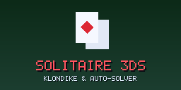
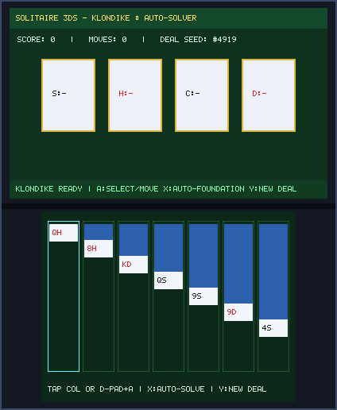
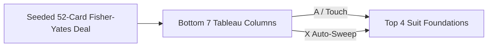

# Solitaire 3DS (`3ds_solitaire`)

<p align="center">
  
  &nbsp;&nbsp;&nbsp;
  
</p>

<p align="center">
  
</p>

> **Klondike & Auto-Solver (`CTR-P-SOLI`, UniqueId `0x0D3EB`)** — Part of the [**lafiabrew**](https://github.com/orgs/lafiabrew/repositories) Nintendo 3DS Homebrew Suite.

Tactile Klondike card solitaire with alternating-color tableau validation, 4 foundation piles, and 1-button auto-foundation solver.

---

## Architecture & Data Flow



---

## Controls & Touch Ergonomics

| Button / Input | Action |
|---|---|
| `D-Pad Left / Right` (or Touch Column) | Select tableau column `1..7` |
| `A` | Promote top card to Foundation or move card stack between columns |
| `X` | Auto-sweep all eligible cards to Foundations |
| `Y` | Deal new seeded hand |

---

## Build, Verify & Install

```bash
make test
make 3ds && make verify-3ds
make qr
```
